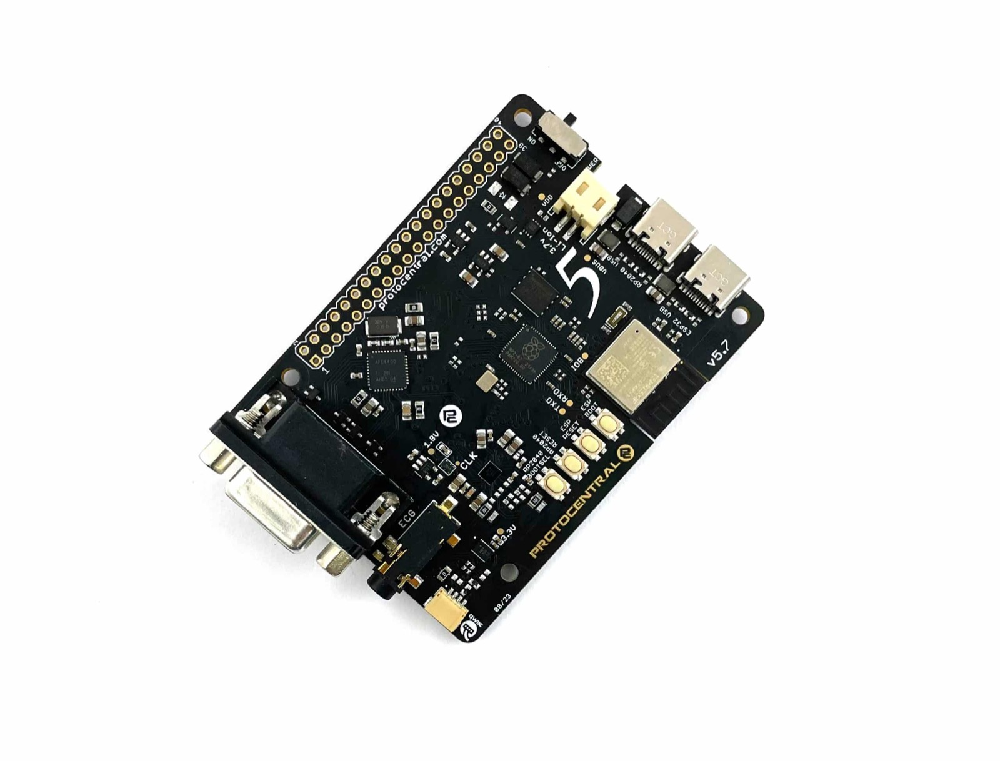
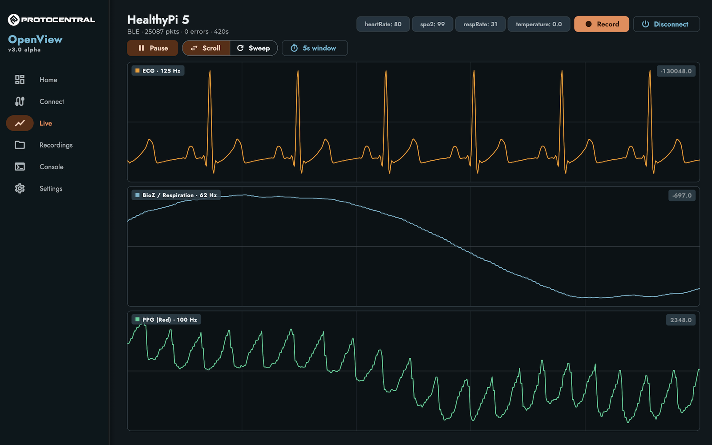
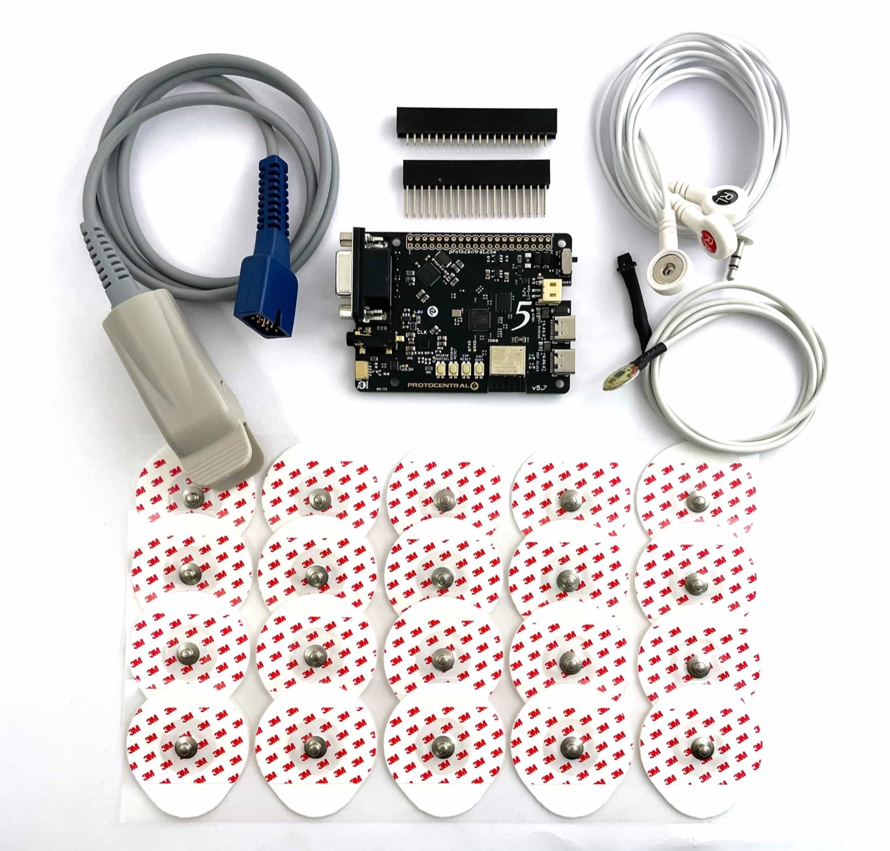
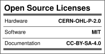

# HealthyPi 5

### The open-source vital signs monitor you can actually build on.

ECG · Respiration · PPG · SpO₂ · Temperature — streamed live over USB, Bluetooth LE or Wi-Fi
from a single Raspberry Pi HAT-sized board.

---

## Why HealthyPi 5

HealthyPi 5 pairs **clinical-grade analog front ends** — the same Maxim and TI parts used in commercial
patient monitors — with a design that is open all the way down.

|  |  |
| --- | --- |
| **Five biosignals, one board** | ECG, respiration, PPG, SpO₂ and temperature simultaneously. |
| **Lossless by design** | The RP2040's two cores split acquisition from everything else — 128 SPS sampling is guaranteed by the architecture, not by tuning. |
| **Connect however you like** | USB-C, BLE or Wi-Fi to OpenView — or log to the onboard microSD with no computer attached. |
| **Genuinely open** | CERN-OHL-P v2 hardware, MIT software, [OSHWA-certified IN000046](https://certification.oshwa.org/in000046.html). Commercial use permitted. |
| **Built to extend** | Qwiic/I²C connectors add GSR, EEG, EMG or any other sensor. |

<b>Live in OpenView</b> — ECG, respiration and PPG over BLE, with recording to disk

## What you can measure

| Signal | Front end | Notes |
| --- | --- | --- |
| **ECG** | Maxim MAX30001 | 18-bit, 128 SPS, 3-electrode cable included |
| **Respiration** | Maxim MAX30001 | Bio-impedance, from the same electrodes |
| **PPG / SpO₂** | TI AFE4400 | 22-bit, red + IR; Nellcor-compatible probe included |
| **Body temperature** | Maxim MAX30205 | Qwiic/I²C skin probe included |
| **Anything else** | Your sensor | Qwiic connectors — GSR, EEG, EMG, … |

## Hardware at a glance

- **RP2040** dual-core ARM Cortex-M0+ main MCU, 16 MB flash
- **ESP32-C3** RISC-V co-processor for Bluetooth LE and Wi-Fi
- **40-pin Raspberry Pi HAT** connector
- **2× USB Type-C** — one per MCU
- **microSD** slot for onboard recording
- **Li-Ion** battery management with USB charging
- **75.5 × 56 × 17 mm**

> Board revisions **5.2 through 5.7 are electrically identical** — one pin map serves all of them.

## Get started

**1. Get a board** — [ProtoCentral Store](https://protocentral.com/product/healthypi-5-vital-signs-monitoring-hat-kit/) · [Mouser](https://www.mouser.com/c/?m=ProtoCentral&q=HealthyPi%205) · [Crowd Supply](https://www.crowdsupply.com/protocentral/healthypi-5)

**2. Install [OpenView](https://github.com/Protocentral/protocentral_openview/releases)** — Windows, macOS, Linux, Android or iOS.

**3. Connect** over USB, BLE or Wi-Fi and start streaming. Boards ship pre-flashed.

Then see the [documentation](https://protocentral.com/product/healthypi-5-vital-signs-monitoring-hat-kit/docs/) for electrode placement, wiring and the streaming data format.

<b>In the kit</b> — board, SpO₂ probe, ECG cable, temperature probe, headers and 20 electrodes

## Software & documentation

This repository holds the **hardware design files**. Everything else lives in its own repository:

| | Repository | What it is |
| --- | --- | --- |
| **App** | [protocentral_openview](https://github.com/Protocentral/protocentral_openview) | **OpenView** — the main GUI. Flutter app for Windows, macOS, Linux, Android and iOS. [Downloads](https://github.com/Protocentral/protocentral_openview/releases) |
| **Firmware** (RP2040) | [protocentral_healthypi_5_firmware](https://github.com/Protocentral/protocentral_healthypi_5_firmware) | Arduino firmware and library — tutorial sketches plus the dual-core NEXT firmware. |
| **Firmware** (ESP32-C3) | [healthybridge-esp32](https://github.com/Protocentral/healthybridge-esp32) | HealthyBridge — wireless co-processor: BLE, Wi-Fi, MQTT, web dashboard. |
| **Docs** | [protocentral.com/healthypi](https://protocentral.com/healthypi/) | Setup, wiring, streaming formats, troubleshooting. |

> **Upgrading firmware?** The RP2040 and ESP32-C3 firmwares must be updated together — v2 changed the protocol between them.

## What's in this repository

| Path | Contents |
| --- | --- |
| [`hardware/`](hardware/) | Eagle `.sch`/`.brd`, BOMs and schematic PDFs — main board revs 5.3–5.7, Pro-Carrier 5.2, ST7796 display add-on 5.2, and enclosure STLs |
| [`docs/images/`](docs/images/) | Images used in this README |
| [`archived/`](archived/) | Unmaintained, kept for reference: the old Processing GUI and Python/LSL scripts, both superseded by OpenView |

## Support

Hardware and errata → [issues here](https://github.com/Protocentral/protocentral_healthypi_5/issues). Firmware → [RP2040](https://github.com/Protocentral/protocentral_healthypi_5_firmware/issues) or [ESP32-C3](https://github.com/Protocentral/healthybridge-esp32/issues). App → [OpenView](https://github.com/Protocentral/protocentral_openview/issues). PRs welcome.

> [!IMPORTANT]
> **HealthyPi 5 is not a medical device.** It is not certified for diagnosis, treatment or any clinical
> use, and must never be relied on for medical decisions — it is for education, research and development
> only. When connected to a person, power the board **only** from a battery or a properly isolated supply.

## License

| | Licence |
| --- | --- |
| **Hardware** (`hardware/`) | [CERN-OHL-P v2](https://ohwr.org/cern_ohl_p_v2.txt) — permissive; you may build and sell products based on this design |
| **Software** | [MIT](http://opensource.org/licenses/MIT) |
| **Documentation** | [CC BY-SA 4.0](http://creativecommons.org/licenses/by-sa/4.0/) |

Distributed WITHOUT ANY EXPRESS OR IMPLIED WARRANTY. Full terms in [LICENSE.md](LICENSE.md).

---

**Part of the HealthyPi family** — [HealthyPi 5](https://protocentral.com/healthypi/) · [HealthyPi 6](https://www.crowdsupply.com/protocentral/healthypi-6) · [HealthyPi Move](https://protocentral.com/product/healthypi-move/)

Designed and built by <a href="https://protocentral.com">ProtoCentral Electronics</a> — open-source biomedical hardware, from sensor to signal.

